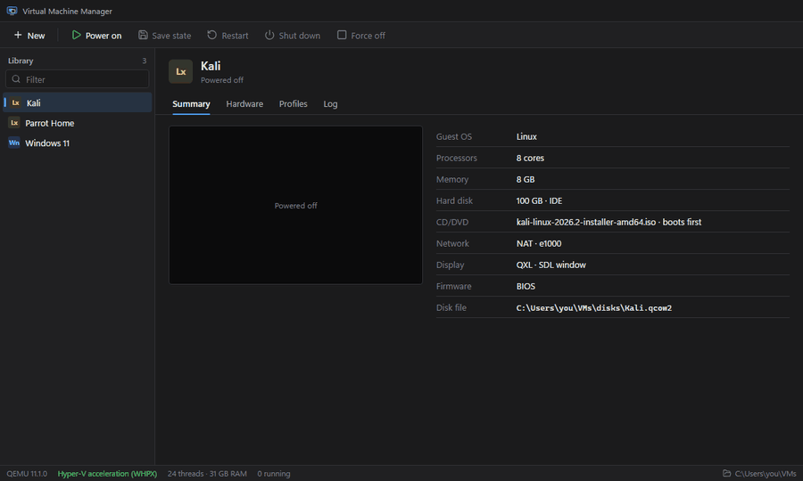
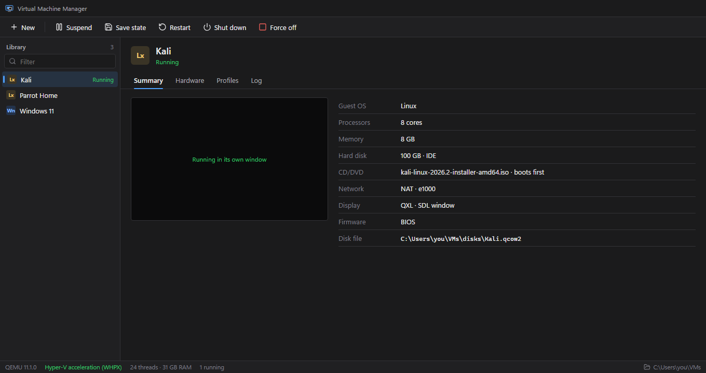
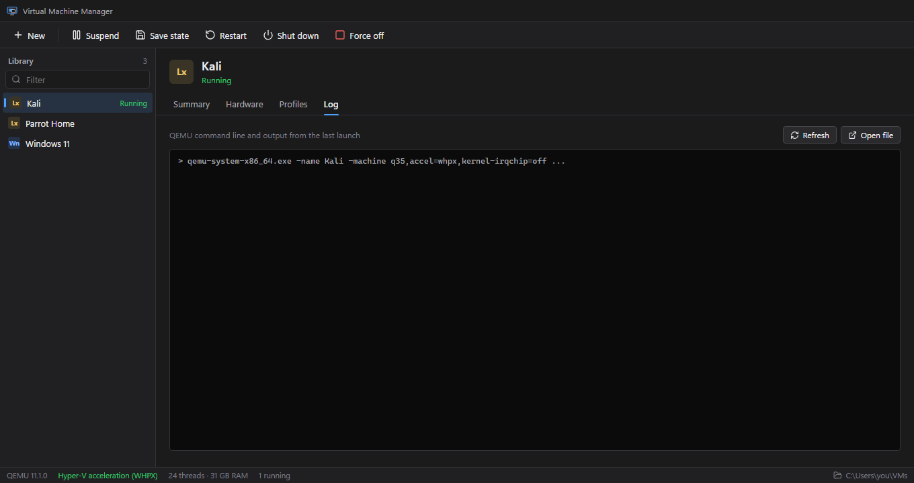
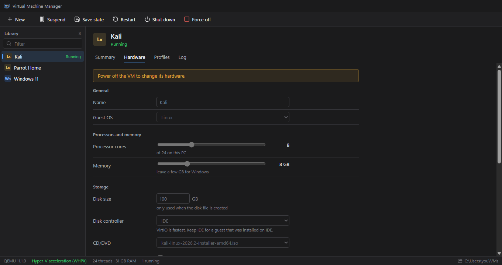
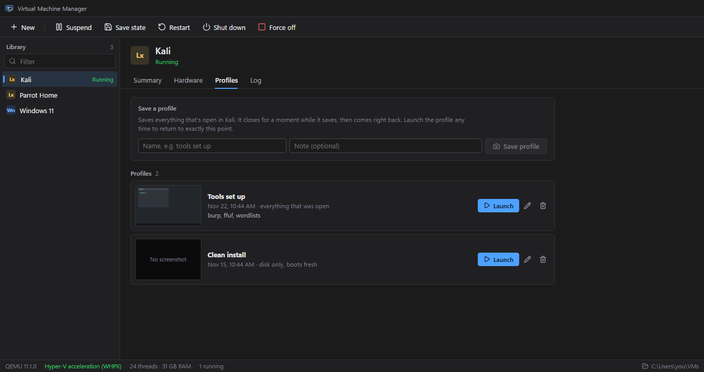

# Virtual Machine Manager

A free desktop app for running virtual machines on Windows. It uses [QEMU](https://www.qemu.org/) with Windows Hypervisor Platform (WHPX) acceleration, so VMs run on the same hypervisor Hyper-V and WSL use. You don't need a VMware or VirtualBox license.

[](https://github.com/A21-devs/Virtual-Machine-Manager/actions/workflows/ci.yml)
[](https://github.com/A21-devs/Virtual-Machine-Manager/releases/latest)
[](https://github.com/A21-devs/Virtual-Machine-Manager/releases)
[](LICENSE)
[](#requirements)
[](https://github.com/A21-devs/Virtual-Machine-Manager/stargazers)



**[Download the installer](https://github.com/A21-devs/Virtual-Machine-Manager/releases/latest)** · [Wiki](https://github.com/A21-devs/Virtual-Machine-Manager/wiki) · [Roadmap](https://github.com/A21-devs/Virtual-Machine-Manager/wiki/Roadmap) · [Discussions](https://github.com/A21-devs/Virtual-Machine-Manager/discussions)

## Why

I wanted something that feels like VMware Workstation but is free and fully mine. It started as a PowerShell + WinForms script (still in [`legacy/`](legacy/)). This repo is the rewrite as a proper Electron + React + TypeScript app.

## Features

**Run VMs**
- Library of your VMs with a filter, status next to each one and the guest OS at a glance
- Power on, suspend, restart, shut down (ACPI, like pressing the power button) and force off
- Hyper-V acceleration (WHPX) when Windows Hypervisor Platform is on, and plain emulation (TCG) when it isn't
- Fast defaults: virtio disk and network, q35 machine, USB tablet so the mouse isn't captured
- **Auto-start:** mark a VM to start when the app opens, and optionally resume its save state

**Save your place**
- **Save state:** close a VM and pick up where you left off next time you power it on
- **Profiles:** save named points in time for a VM ("tools set up", "clean install") with a screenshot and a note, then **Launch** any of them later to go straight back to that moment
- A profile keeps everything that was open in the guest. It's taken while the VM runs, and works for Debian/Ubuntu-based Linux guests today

**Set them up**
- Hardware tab: name, guest OS, CPU cores and RAM (sliders that know your PC's limits), disk size and controller, CD/DVD image and whether it boots first, network mode and adapter, graphics, BIOS or UEFI, acceleration and extra QEMU arguments
- Hardware can't be changed while a VM is running, and unsaved edits block Power on so nothing runs with half-applied settings
- Log tab with each VM's QEMU output, for when a guest won't boot
- Reads VM configs made by the old PowerShell version, so nothing has to be recreated

| | |
|---|---|
|  |  |
| **Summary:** what the VM is running with, at a glance. | **Log:** QEMU's own output, for when a guest won't boot. |
|  |  |
| **Hardware:** every setting in one place, with hints for the ones that are easy to get wrong. | **Profiles:** save a moment, launch it again later. |

## Requirements

- Windows 10 or 11, 64-bit
- **Windows Hypervisor Platform** turned on: Start → "Turn Windows features on or off" → tick *Windows Hypervisor Platform* → restart. Without it VMs still run, just much slower.
- [QEMU for Windows](https://qemu.weilnetz.de/w64/) installed in `C:\Program Files\qemu` (the installer's default), or its files copied into `%USERPROFILE%\VMs\qemu`

## Install

1. Download `Virtual-Machine-Manager-Setup-<version>.exe` from the [latest release](https://github.com/A21-devs/Virtual-Machine-Manager/releases/latest).
2. Run it. It installs for your user only, no admin needed, and you can pick the folder.
3. The installer isn't code signed yet, so Windows SmartScreen may warn you the first time. Click **More info → Run anyway**.

## Your first VM

1. Put an installer ISO in `%USERPROFILE%\VMs\ISOs` (Kali, Ubuntu, Windows, anything QEMU boots).
2. Click **New**. The Hardware form opens for the new VM.
3. Fill it in: name, guest OS, the ISO under CD/DVD, cores and memory. Save.
4. Click **Power on**. The VM opens in its own window.

More walkthroughs are in the [wiki](https://github.com/A21-devs/Virtual-Machine-Manager/wiki).

## Where your VMs live

Everything is in `%USERPROFILE%\VMs`:

```
VMs/
  vms/      one .json config per VM
  disks/    qcow2 disk images
  ISOs/     installer images
  qemu/     QEMU binaries (optional, otherwise C:\Program Files\qemu is used)
  profiles/ profile details and screenshots
  logs/     per-VM launch logs
```

Uninstalling the app never touches this folder.

## FAQ

**Is it really free?** Yes. MIT licensed, no account, no telemetry. It runs entirely on your PC.

**Does it work alongside WSL, Docker Desktop or Hyper-V?** Yes. WHPX is the same hypervisor they use, which is why VMware and VirtualBox often fight with them and this doesn't.

**Why does saving a profile close the VM for a moment?** With WHPX, QEMU can't snapshot a running guest's memory, so the guest hibernates itself, the disk is snapshotted, and the VM starts again. Launching the profile resumes from that hibernation.

**Which guests can keep open apps in a profile?** Linux guests based on Debian or Ubuntu (Kali, Ubuntu, Mint, Parrot) after a one-time setup command that the app shows you the first time. Windows guests aren't supported yet ([#42](https://github.com/A21-devs/Virtual-Machine-Manager/issues/42)), and neither are profiles of a powered-off VM ([#17](https://github.com/A21-devs/Virtual-Machine-Manager/issues/17)).

**Can I use my existing VMs?** Any qcow2 disk works: put it in `VMs\disks` and point a new VM at it. VMs from the old PowerShell version show up on their own.

## Build from source

Needs Node.js 24+.

```bash
npm install
npm run dev        # the app with hot reload
npm run dev:web    # just the UI in a browser, with a fake backend (no QEMU needed)
```

| script | what it does |
| --- | --- |
| `npm test` | unit tests (Vitest) |
| `npm run test:qemu` | also runs integration tests against a real QEMU |
| `npm run typecheck` | TypeScript check |
| `npm run build` | production build into `out/` |
| `npm run dist` | Windows installer into `release/` |

Releases are built by GitHub Actions: pushing a `v*` tag that matches `package.json`'s version runs the tests and publishes the installer.

### Project layout

```
src/
  main/       Electron main process: spawns QEMU, talks to it over QMP and the guest agent
  preload/    the safe bridge between main and the UI
  renderer/   React UI
  shared/     plain TypeScript used by both sides (config model, QEMU args)
tests/        Vitest unit tests, plus integration tests that boot QEMU
legacy/       the original PowerShell version
```

## Roadmap

What's shipped, what's next and what's only an idea is on the [Roadmap](https://github.com/A21-devs/Virtual-Machine-Manager/wiki/Roadmap) wiki page. Next up is mostly in the [open issues](https://github.com/A21-devs/Virtual-Machine-Manager/issues). Ideas go in [Discussions](https://github.com/A21-devs/Virtual-Machine-Manager/discussions/categories/ideas).

## Getting help

- How-to guides: the [wiki](https://github.com/A21-devs/Virtual-Machine-Manager/wiki)
- Questions: [Discussions](https://github.com/A21-devs/Virtual-Machine-Manager/discussions)
- Bugs: [open an issue](https://github.com/A21-devs/Virtual-Machine-Manager/issues/new/choose) with the VM's Log tab
- Security problems: privately, see [SECURITY.md](SECURITY.md)

It's one maintainer, so expect a reply within a few days. More in [SUPPORT.md](SUPPORT.md).

## Contributing

Bug reports and PRs are welcome. Issues labelled [first issue](https://github.com/A21-devs/Virtual-Machine-Manager/labels/first%20issue) are small and self-contained. See [CONTRIBUTING.md](CONTRIBUTING.md) for how to set up and what a PR needs.

## Credits

Built by me, with help from [Claude](https://claude.ai) (Anthropic) as a coding assistant.

## License

[MIT](LICENSE)
